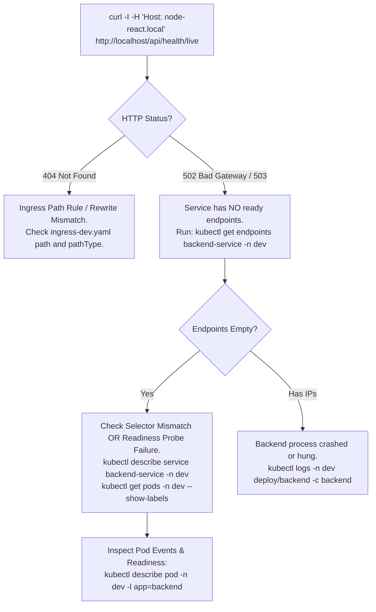
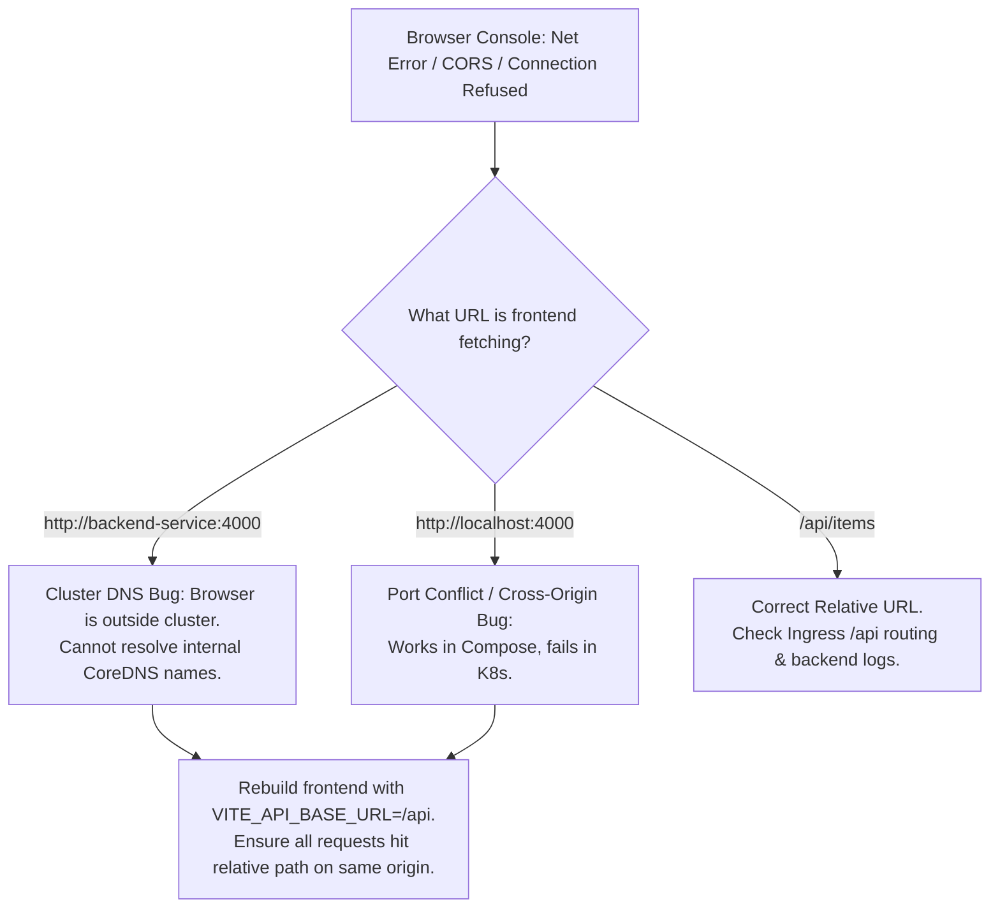

# Node + React + PostgreSQL Platform — DevOps Assessment

A production-style platform built across six incremental layers: **Docker Compose containerization**, **Kubernetes orchestration**, **Ingress API Gateway & rate limiting**, **multi-environment CI/CD**, **platform services (Redis, BullMQ, OpenSearch, read/write DB split)**, and **observability & autoscaling (Prometheus, Grafana, Fluent Bit, Loki, HPA)**.

---

## Repository Structure

```
.
├── Dockerfile.backend                 # Multi-stage build (Alpine, non-root user)
├── Dockerfile.frontend                # Multi-stage build (Vite -> Nginx Alpine)
├── .dockerignore                      # Optimized build context filtering
├── docker-compose.yml                 # Full multi-service local environment
├── kind-config.yaml                   # Kind cluster configuration with port mappings
├── backend/                           # Node.js/Express API + BullMQ worker + Prometheus metrics
│   ├── src/
│   │   ├── index.js                   # Express routes & probes (/live, /ready, /metrics)
│   │   ├── db.js                      # Simulated read/write DB split (writePool / readPool)
│   │   ├── metrics.js                 # Prometheus prom-client metrics collector
│   │   ├── queue.js                   # BullMQ producer
│   │   ├── worker.js                  # BullMQ consumer
│   │   ├── redisClient.js             # Redis connection client
│   │   └── search.js                  # OpenSearch cluster health client
│   ├── package.json
│   └── .env.example
├── frontend/                          # React SPA
│   ├── src/App.jsx                    # React UI interacting with API
│   ├── nginx.conf                     # Nginx SPA fallback configuration
│   └── package.json
├── k8s/                               # Kubernetes manifests (Namespace: dev)
│   ├── namespace-dev.yaml             # Namespace specification
│   ├── app-configmap.yaml             # Environment configuration (non-sensitive)
│   ├── app-secrets.yaml               # Database credentials (base64 Secret)
│   ├── postgres-pv.yaml               # PersistentVolume (1Gi, hostPath)
│   ├── postgres-pvc.yaml              # PersistentVolumeClaim (1Gi)
│   ├── postgres-statefulset.yaml      # Postgres StatefulSet with probes and PVC
│   ├── postgres-service.yaml          # ClusterIP service (:5432)
│   ├── backend-deployment.yaml        # Express API (2 replicas, live/ready probes, metrics annotations)
│   ├── backend-service.yaml           # ClusterIP service (:4000)
│   ├── frontend-deployment.yaml       # React Nginx SPA (2 replicas, probes, resource limits)
│   ├── frontend-service.yaml          # NodePort service (:30080)
│   ├── ingress-dev.yaml               # Nginx Ingress Controller rules with rate limiting
│   ├── redis-deployment.yaml          # Redis Deployment with TCP health probes
│   ├── redis-service.yaml             # ClusterIP service (:6379)
│   ├── bullmq-worker-deployment.yaml  # Queue consumer deployment
│   ├── search-deployment.yaml         # OpenSearch single-node dev mode
│   └── search-service.yaml            # ClusterIP service (:9200)
├── observability/                     # Observability & Autoscaling
│   ├── prometheus.yaml                # Prometheus Deployment, auto-scrape ConfigMap, RBAC
│   ├── grafana.yaml                   # Grafana Deployment, pre-provisioned datasources, NodePort :30300
│   ├── fluentbit-daemonset.yaml       # Fluent Bit DaemonSet shipping container logs to Loki
│   ├── loki.yaml                      # Loki log aggregation engine (:3100)
│   └── hpa-backend.yaml               # HorizontalPodAutoscaler (2->6 replicas, CPU 70%, Memory 80%)
├── .github/workflows/
│   └── ci-cd.yml                      # Multi-env CI/CD pipeline (dev, preprod, release) + Rollback
├── docs/                              # Evidence, logs, and architecture documentation
│   ├── architecture.md
│   └── evidence.md
└── README.md
```

---

## 1. Prerequisites & One-Command Startup

### Prerequisites
* **Docker & Docker Compose** (Docker Desktop with WSL2 on Windows or Linux Docker Engine)
* **kubectl** (v1.28+)
* **kind** (v0.20+) or **minikube** (v1.30+)
* Standard ports free: `80`, `443`, `4000`, `5432`, `6379`, `8080`, `9200`, `30080`, `30300`.

---

### A. Docker Compose (One Command)

```bash
docker compose up --build -d
```

#### Access Endpoints:
* **Frontend UI:** [http://localhost:8080](http://localhost:8080)
* **Backend API Health:** [http://localhost:4000/api/health](http://localhost:4000/api/health)
* **Backend Liveness:** [http://localhost:4000/api/health/live](http://localhost:4000/api/health/live)
* **Backend Readiness:** [http://localhost:4000/api/health/ready](http://localhost:4000/api/health/ready)
* **Redis Health:** [http://localhost:4000/api/health/redis](http://localhost:4000/api/health/redis)
* **OpenSearch Health:** [http://localhost:4000/api/health/search](http://localhost:4000/api/health/search)
* **Prometheus Metrics:** [http://localhost:4000/metrics](http://localhost:4000/metrics)
* **PostgreSQL:** `localhost:5432` (database `appdb`, user `appuser`, password `apppass`, persisted via named volume `postgres_data`).

#### Teardown:
```bash
docker compose down -v
```

---

### B. Kubernetes via Kind / Minikube (One Script / Step-by-Step)

#### Option 1: Using Kind

1. **Create cluster with ingress and NodePort port mappings:**
   ```bash
   kind create cluster --config kind-config.yaml
   ```

2. **Install Nginx Ingress Controller:**
   ```bash
   kubectl apply -f https://raw.githubusercontent.com/kubernetes/ingress-nginx/main/deploy/static/provider/kind/deploy.yaml
   kubectl wait --namespace ingress-nginx --for=condition=ready pod --selector=app.kubernetes.io/component=controller --timeout=120s
   ```

3. **Map friendly hostname in `/etc/hosts` (Linux/macOS) or `C:\Windows\System32\drivers\etc\hosts` (Windows):**
   ```text
   127.0.0.1 node-react.local
   ```

4. **Build and load local images into Kind:**
   ```bash
   docker build -f Dockerfile.backend -t ghcr.io/mdmusfikurrahmansifar/node-react-postgres-platform-assessment-project-backend:dev-latest .
   docker build -f Dockerfile.frontend --build-arg VITE_API_BASE_URL=/api -t ghcr.io/mdmusfikurrahmansifar/node-react-postgres-platform-assessment-project-frontend:dev-latest .

   kind load docker-image ghcr.io/mdmusfikurrahmansifar/node-react-postgres-platform-assessment-project-backend:dev-latest --name dev-cluster
   kind load docker-image ghcr.io/mdmusfikurrahmansifar/node-react-postgres-platform-assessment-project-frontend:dev-latest --name dev-cluster
   ```

5. **Deploy all manifests to `dev` namespace:**
   ```bash
   kubectl apply -f k8s/namespace-dev.yaml
   kubectl apply -f k8s/
   kubectl apply -f observability/
   ```

6. **Verify rollout:**
   ```bash
   kubectl get all -n dev
   ```

#### Option 2: Using Minikube

```bash
minikube start --driver=docker --memory=4096 --cpus=2
minikube addons enable ingress
minikube addons enable metrics-server

# Point terminal to Minikube's Docker daemon
eval $(minikube docker-env)

# Build images directly in Minikube's Docker context
docker build -f Dockerfile.backend -t ghcr.io/mdmusfikurrahmansifar/node-react-postgres-platform-assessment-project-backend:dev-latest .
docker build -f Dockerfile.frontend --build-arg VITE_API_BASE_URL=/api -t ghcr.io/mdmusfikurrahmansifar/node-react-postgres-platform-assessment-project-frontend:dev-latest .

# Deploy manifests
kubectl apply -f k8s/namespace-dev.yaml
kubectl apply -f k8s/
kubectl apply -f observability/

# Map minikube IP to node-react.local in hosts file
echo "$(minikube ip) node-react.local" | sudo tee -a /etc/hosts
```

---

## 2. Request Path & Kubernetes DNS Resolution

### The Full Request Path
```
Browser ──► /etc/hosts (127.0.0.1) ──► Nginx Ingress Controller (:80)
                                            │
               ┌────────────────────────────┴───────────────────────────┐
               ▼                                                        ▼
         Path: "/"                                               Path: "/api/*"
               │                                                        │
               ▼                                                        ▼
       frontend-service:80                                      backend-service:4000
       (NodePort / ClusterIP)                                   (ClusterIP)
               │                                                        │
               ▼                                                        ▼
         frontend Pod                                             backend Pod
   (Nginx serving static bundle)                           (Express API Node.js)
                                                                 │        │
                                                   writePool ────┘        └──── readPool
                                                        │                         │
                                                        ▼                         ▼
                                                  postgres-service         postgres-service
                                                        │                         │
                                                        └───────────┬─────────────┘
                                                                    ▼
                                                               postgres Pod
                                                             (StatefulSet/PVC)
```

1. **Resolution:** The user enters `http://node-react.local/api/items`. The host `/etc/hosts` resolves `node-react.local` to `127.0.0.1` (or Minikube IP).
2. **Ingress Routing:** Traffic enters the cluster through the **Nginx Ingress Controller**. The ingress controller inspects host header (`node-react.local`) and path prefix:
   * `/` routes to upstream `frontend-service:80`.
   * `/api` and `/api/*` route to upstream `backend-service:4000`.
3. **Internal Load Balancing:** `backend-service` utilizes `kube-proxy` iptables/IPVS rules to load-balance traffic across Ready `backend` pods.
4. **Data Operations:** The backend executes write operations against `DB_WRITE_URL` (`writePool`) and read queries against `DB_READ_URL` (`readPool`).
5. **Background Fan-out:** On item creation, the backend sends a job into BullMQ (`redis-service:6379`). The independent `bullmq-worker` pod dequeues and processes the job asynchronously.

---

### How Kubernetes DNS Resolves Services

Every Kubernetes service receives an internal A/AAAA record generated by **CoreDNS** adhering to the standard naming convention:

$$\text{<service-name>}.\text{<namespace>}.\text{svc}.\text{cluster}.\text{local}$$

Examples in this cluster:
* `postgres-service.dev.svc.cluster.local` $\rightarrow$ Points to Postgres ClusterIP (`5432`).
* `backend-service.dev.svc.cluster.local` $\rightarrow$ Points to Backend ClusterIP (`4000`).
* `redis-service.dev.svc.cluster.local` $\rightarrow$ Points to Redis ClusterIP (`6379`).
* `search-service.dev.svc.cluster.local` $\rightarrow$ Points to OpenSearch ClusterIP (`9200`).

#### Resolution Scope Rules:
1. **Same Namespace (`dev`):** Pods inside `dev` can simply call short names: `postgres-service`, `redis-service`, `search-service`. The container `/etc/resolv.conf` automatically appends the search domain `dev.svc.cluster.local`.
2. **Cross Namespace:** Callers outside `dev` must address `postgres-service.dev` or the FQDN.
3. **Why Pod IPs are Never Hardcoded:** Pod IPs are ephemeral and change whenever pods restart or scale. The Service ClusterIP is durable, and CoreDNS dynamically routes connections to whichever pods currently pass readiness probes (`kubectl get endpoints`).

---

## 3. Debugging Scenarios Playbook

### Scenario A: Ingress is reachable, but the backend is not (HTTP 502 / 503 / 404)



#### Step-by-Step Diagnostic Commands:
1. **Check Ingress Controller Logs:**
   ```bash
   kubectl logs -n ingress-nginx -l app.kubernetes.io/component=controller --tail=50
   ```
   *Look for upstream connection refused or path match misses.*

2. **Check Service Endpoints:**
   ```bash
   kubectl get endpoints backend-service -n dev
   ```
   *If `ENDPOINTS` is `<none>`, the service cannot locate any pods that have passed readiness probes.*

3. **Verify Selector Matching:**
   ```bash
   kubectl get service backend-service -n dev -o jsonpath='{.spec.selector}'
   kubectl get pods -n dev --show-labels
   ```
   *Verify `app: backend` matches exactly between Deployment template labels and Service selector.*

4. **Verify Readiness Probe Status:**
   ```bash
   kubectl describe pod -n dev -l app=backend | grep -i readiness
   ```
   *If readiness failed, the backend pod is running but prevented from receiving traffic because the database or ping check failed.*

---

### Scenario B: The frontend cannot talk to the backend (Browser Console Network Error)



#### Root Causes & Solutions:
1. **Cluster DNS Called from Host Browser:**
   * *Problem:* Browser makes HTTP calls from the client's host OS. The hostname `backend-service` exists solely within cluster CoreDNS.
   * *Solution:* In Kubernetes, the frontend must use relative URLs (`/api`) so requests target the same origin (`http://node-react.local/api/*`). The Ingress then routes them to `backend-service:4000`.
2. **Hardcoded Port / Build-time Inlining:**
   * *Problem:* Vite bakes `import.meta.env.VITE_API_BASE_URL` into JavaScript assets at **build time**.
   * *Solution:* In the multi-stage Docker build, pass `--build-arg VITE_API_BASE_URL=/api` during the Kubernetes image build.
3. **CORS Headers:**
   * If accessing frontend and backend across different origins/ports, Express requires `cors({ origin: 'http://node-react.local' })`. By proxying both through Ingress on port 80 under `node-react.local`, CORS issues are eliminated entirely.

---

## 4. CI/CD Architecture, Secrets & Rollback Strategy

### Pipeline Flow (`.github/workflows/ci-cd.yml`)
The workflow automates build, test, multi-environment deployments, and rollback across branches:

| Branch Pattern | Target Namespace | Environment Stage | Deployment Trigger |
|---|---|---|---|
| `master` / `main` | `dev` | Continuous Integration / Development | Automatic on push |
| `pre-release/v*` | `preprod` | Staging / QA Validation | Automatic on push |
| `release/v*` | `release` | Production Release | Automatic on push |

```
Push to branch ──► [Job: build-and-test] (npm ci, syntax validation, build)
                         │
                         ▼
                   [Job: build-and-push]
                   - Tag: <branch>-<short-sha> (Immutable)
                   - Tag: <namespace>-latest (Human convenience)
                   - Push to GitHub Container Registry (GHCR)
                         │
                         ▼
                   [Job: deploy]
                   - Decode KUBECONFIG_B64
                   - sed patch image tags into manifests
                   - kubectl apply -n <namespace>
                   - kubectl rollout status --timeout=120s
```

---

### Secrets Storage & Handling

| Secret Name | Storage Location | Scope & Usage | Rotation Policy |
|---|---|---|---|
| `GITHUB_TOKEN` | Automatic GitHub Actions Secret | Scoped ephemeral token with `packages: write` permissions for GHCR push. | Regenerated per workflow run. |
| `KUBECONFIG_B64` | Encrypted Repository Secret | Base64-encoded Kubeconfig restricted to target deployment namespaces. | Rotated every 90 days. |
| `app-secrets` (`DB_PASSWORD`) | Kubernetes Secret (`k8s/app-secrets.yaml`) | Encrypted at rest in cluster, mounted into pods via `secretRef`. Never committed unencrypted to git. | Synchronized from external vault (Vault/AWS SM). |

---

### Rollback Strategy

The platform provides two complementary rollback mechanisms:

#### 1. Fast Path — Immediate Mitigation (`kubectl rollout undo`)
* **When to use:** Production incident requiring sub-minute recovery.
* **Mechanism:** Reverts the Kubernetes Deployment to the preceding revision in ReplicaSet history:
  ```bash
  kubectl rollout undo deployment/backend -n dev
  kubectl rollout undo deployment/frontend -n dev
  kubectl rollout status deployment/backend -n dev
  ```
* **Automated via CI:** Triggered on-demand using GitHub Actions `workflow_dispatch` with input parameter `rollback_namespace: dev`.

#### 2. Deterministic Path — Known-Good Git Revert
* **When to use:** Permanent, auditable fix.
* **Mechanism:** Every build is tagged with the commit SHA (`master-a1b2c3d`). Reverting the commit in Git (`git revert <bad-commit>`) triggers the pipeline to rebuild and redeploy the exact verified tag without relying on in-cluster ReplicaSet history retention.

---

## 5. Read/Write Database Split & Replication Lag

### Architecture
The backend ([db.js](file:///c:/Users/MD%20.%20MUSFIKUR%20RAHMAN/Downloads/Projects/DevOps%20Assessment/node-react-postgres-platform/backend/src/db.js)) simulates a database cluster by maintaining two independent connection pools:
* `writePool`: Connected via `DB_WRITE_URL` $\rightarrow$ points to primary PostgreSQL database (INSERT, UPDATE, DELETE, DDL).
* `readPool`: Connected via `DB_READ_URL` $\rightarrow$ points to read replica (SELECT).

```javascript
// backend/src/db.js
const writePool = new Pool({ connectionString: process.env.DB_WRITE_URL });
const readPool  = new Pool({ connectionString: process.env.DB_READ_URL });

export const write = (query, params) => writePool.query(query, params);
export const read  = (query, params) => readPool.query(query, params);
```

### Where Read/Write Routing Logic Lives: Trade-off Comparison

| Pattern | Implementation | Pros | Cons |
|---|---|---|---|
| **Application Layer (Current)** | Explicit `write()` vs `read()` methods in codebase. | Transparent, fully testable, zero extra infrastructure hops or failure modes. | Developers must manually maintain discipline to choose the correct helper. |
| **Database Proxy** | PgBouncer, ProxySQL, or AWS RDS Proxy read/write split endpoints. | Completely transparent to application code; centralized routing rules. | Additional infrastructure component to operate; introduces extra network hop. |
| **ORM / Data Access Layer** | Prisma / TypeORM read-replica routing middleware. | Enforced by ORM query types automatically. | Strongly coupled to specific ORM framework; less granular control. |

---

### The Replication Lag Trap (Read-Your-Own-Writes)

In asynchronous replication, PostgreSQL streaming replication transmits Write-Ahead Logs (WAL) with a delay ($\Delta t$):

```
t=0ms    User adds item: POST /api/items  ──► writePool (Primary) ──► INSERT committed
t=5ms    User redirected: GET /api/items  ──► readPool (Replica)  ──► Replica hasn't received WAL!
t=5ms    ❌ Stale response: newly created item missing from list!
t=45ms   Replica applies WAL
t=50ms   Subsequent GET /api/items        ──► readPool (Replica)  ──► ✅ Item present
```

#### Mandatory Rules to Prevent Inconsistencies:
1. **Critical Read-Your-Own-Writes Operations Must Hit the Writer:**
   * Any read immediately following a write (e.g. redirect-after-POST, order confirmation, profile update verification) must bypass `readPool` and query `writePool`.
2. **Uniqueness & Constraint Verification:**
   * Pre-insert uniqueness checks (e.g., checking if username/email exists) must query `writePool` to avoid race conditions.
3. **Analytics & Bulk Reporting:**
   * Heavy reporting, aggregations, and batch jobs must run exclusively against `readPool` to prevent starving the primary of connection slots and CPU.
4. **Monitoring Replication Lag:**
   * Continuously scrape `pg_stat_replication.replay_lag` and alert when lag exceeds 1 second.

---

## 6. Observability, Alerting & Autoscaling

### Observability Pipeline
* **Metrics:** Prometheus scrapes annotated pods (`prometheus.io/scrape: "true"`) every 15s. Express exports application metrics via `prom-client` on `/metrics`.
* **Dashboards:** Grafana ([NodePort 30300](http://localhost:30300), credentials: `admin`/`admin`) with pre-provisioned Prometheus and Loki datasources.
* **Logging:** Fluent Bit runs as a **DaemonSet** tailing `/var/log/containers/*.log` on each node, parses container logs, and streams structured logs into Loki.
* **Autoscaling:** HorizontalPodAutoscaler (`backend-hpa`) scales backend pods from 2 to 6 replicas based on CPU (70%) and Memory (80%) utilization.
* **Rate Limiting:** Enforced at the Ingress controller edge (`limit-rps: "10"`, `limit-burst-multiplier: "5"`, `limit-connections: "20"`).

---

### Key Operational Metrics & Alerting Strategy

| Metric | Prometheus Query | Alert Threshold | Operational Rationale |
|---|---|---|---|
| **High Error Rate (5xx)** | `sum(rate(http_requests_total{status=~"5.."}[5m])) / sum(rate(http_requests_total[5m])) * 100` | `> 2% for 3m` (P1) | Immediate signal of user-facing service failure, independent of traffic volume. |
| **High Latency (p99)** | `histogram_quantile(0.99, sum(rate(http_request_duration_seconds_bucket[5m])) by (le))` | `> 500ms for 5m` (P2) | Detects database query degradation, connection pool exhaustion, or event-loop blocking before outright 500 errors occur. |
| **High CPU Saturation** | `sum(rate(container_cpu_usage_seconds_total{container="backend"}[5m])) by (pod) / sum(kube_pod_container_resource_limits{container="backend",resource="cpu"}) by (pod) * 100` | `> 85% for 5m` (P2) | Pods approaching CPU limits suffer thread throttling and latency spikes. |
| **HPA Max Replicas Reached** | `kube_deployment_status_replicas{deployment="backend"} == 6` | `Duration > 10m` (P2) | Autoscaler is maxed out; cluster has run out of scaling headroom to handle further load. |
| **Replication Lag** | `pg_stat_replication_replay_lag > 5` | `> 5s for 2m` (P1) | Read queries are serving stale data; risk of severe read-your-own-writes inconsistencies. |
| **Worker Queue Growth** | `bullmq_jobs_waiting > 1000` | `> 1000 for 5m` (P3) | Consumer workers are falling behind; background indexing and notification lag is accumulating. |

---

## 7. Design Decisions, Trade-offs & Production Roadmap

### Key Architecture Decisions & Trade-offs

| Decision | Selected Choice | Trade-off / Alternative | Engineering Rationale |
|---|---|---|---|
| **Container Images** | Multi-stage Docker builds with Alpine Linux | Single-stage standard Node image | Yields **51MB** backend and **21MB** frontend images (vs ~1GB), eliminates build tool attack surface, improves pull latency. |
| **Container Security** | Non-root `USER node` execution context | Default root user | Container escape mitigation; enforces least-privilege security principle. |
| **External Access** | Nginx Ingress Controller as API Gateway | Direct NodePort / LoadBalancer per service | Centralizes unified hostname access, TLS termination, path routing, and edge rate limiting in one place. |
| **Autoscaling Baseline** | `minReplicas: 2`, `scaleDown: 300s window` | `minReplicas: 1`, immediate scale-down | Prevents single-point-of-failure outages during rolling updates; stabilization window dampens oscillation/flapping under bursty traffic. |
| **Probe Design** | Independent Liveness (`/live`) and Readiness (`/ready`) | Single health probe | Liveness checks only process responsiveness (preventing database outages from triggering pod restart storms). Readiness checks external dependencies to isolate unready pods from traffic. |
| **Queue Architecture** | BullMQ over Redis | RabbitMQ / Kafka | Reuses existing Redis caching infrastructure; provides low-latency job persistence and retry backoff without broker overhead. |

---

### What to Add in a Full Production Deployment

If taking this platform to live production on AWS EKS or GCP GKE:

1. **Automated TLS & Certificate Management:** Deploy `cert-manager` with Let's Encrypt ACME Issuer for automatic HTTPS certificate issuance and renewal at the Ingress.
2. **External Secrets Operator (ESO):** Replace committed base64 Secrets with AWS Secrets Manager or HashiCorp Vault synchronized dynamically into K8s Secrets.
3. **Distributed Tracing (OpenTelemetry + Jaeger / Tempo):** Propagate W3C Trace Context headers across Frontend $\rightarrow$ Ingress $\rightarrow$ Backend $\rightarrow$ BullMQ Worker to correlate latency spans across asynchronous workflows.
4. **Network Policies:** Implement Calico/Cilium `NetworkPolicy` resources to enforce strict micro-segmentation (e.g. only backend pods can communicate with Postgres and Redis on ports 5432 and 6379).
5. **GitOps CD (ArgoCD / Flux):** Replace imperative `kubectl apply` in GitHub Actions with declarative GitOps reconciliation.
6. **Managed Cloud Storage:** Replace node-local `hostPath` PersistentVolumes with cloud storage classes (AWS EBS `gp3` or GCP Persistent Disk CSI).
7. **Multi-Node OpenSearch Cluster:** Transition from dev single-node mode to a 3-node HA cluster with TLS security, shard replication, and dedicated master nodes.
